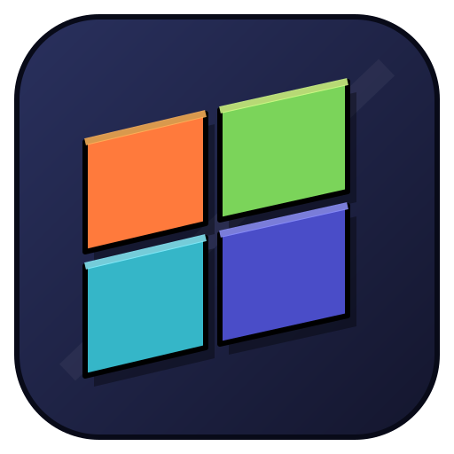
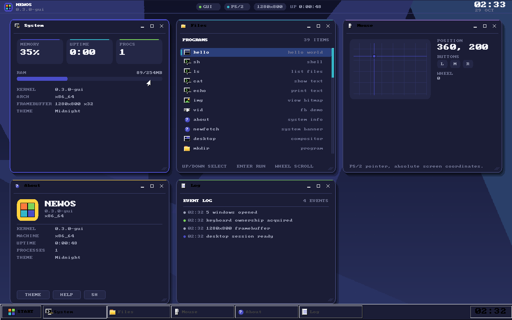
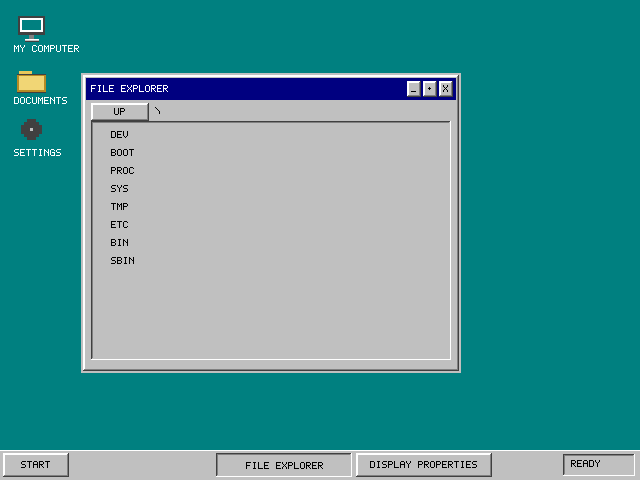
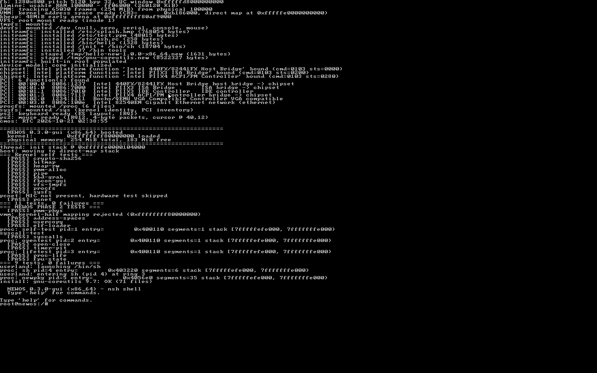
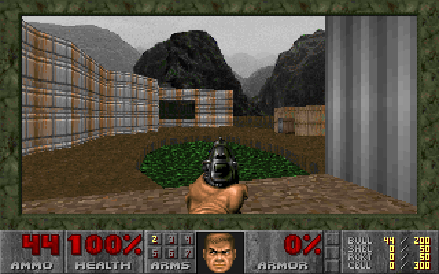
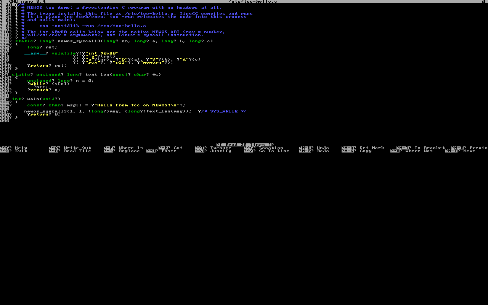
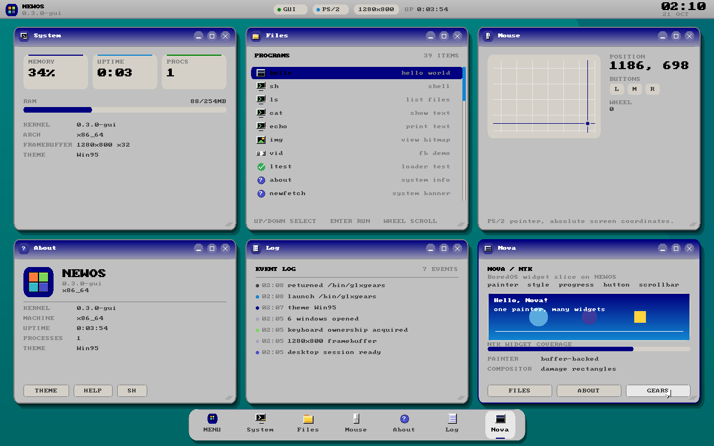

<p align="center">
  
</p>

<h1 align="center">NEWOS</h1>
<p align="center"><strong>Un sistema operativo independiente, construido desde cero.</strong></p>
<p align="center">x86_64 · 0.3.0-gui · Licencia MIT</p>

<p align="center">
  <a href="https://cristop-bot.github.io/NEWOS/"><strong>Visitar el sitio de NEWOS ↗</strong></a>
  &nbsp;·&nbsp; <a href="https://github.com/CRISTOP-bot/NEWOS">Código fuente</a>
  &nbsp;·&nbsp; <a href="web/downloads.html">Descargas</a>
</p>

---

NEWOS explora cómo construir un sistema operativo como un proyecto propio: desde el arranque y las capas del kernel hasta el userland y su entorno gráfico. No es una distribución de Linux. Su arquitectura principal y el estado que se describe aquí corresponden a **x86_64**; configuraciones para otras arquitecturas no deben interpretarse como soporte funcional.

La intención es simple: hacer visibles las decisiones de ingeniería y mantener claros los límites de lo que ya está implementado.

## Capturas reales

Imágenes del proyecto tomadas durante ejecuciones en QEMU. Son capturas de NEWOS; no maquetas de producto. Las funciones, el nivel de detalle y la versión visible pueden variar entre capturas.

| Escritorio NEWOS | Sesión gráfica VOXEL |
|---|---|
|  |  |
| Consola de arranque | Aplicaciones en el framebuffer |
|  |  |
| GNU nano | Tema alternativo del escritorio |
|  |  |

[Ver la galería completa en el sitio web](https://cristop-bot.github.io/NEWOS/#capturas).

## Estado del proyecto

El README y los workflows del repositorio documentan builds y pruebas de arranque en QEMU para x86_64. Estas verificaciones no equivalen a soporte general de hardware físico. Consulta el workflow y sus logs para confirmar el resultado del commit que quieras probar.

El árbol del proyecto incluye, entre otras piezas, kernel freestanding x86_64, arranque PVH/Multiboot2/Limine, manejo de memoria, VFS y backends de sistema de archivos, procesos/syscalls, shell `nsh`, userland y un entorno gráfico. Hay puertos y dependencias de terceros: sus licencias y avisos aplican a cada componente.

**Límites que conviene conocer:** la persistencia, red y compatibilidad de hardware dependen de las implementaciones presentes en el código y de las pruebas correspondientes. No asumas que una imagen de QEMU prueba soporte en equipos reales. Consulta [la documentación](https://cristop-bot.github.io/NEWOS/docs.html) y [el roadmap](ROADMAP.md) antes de tratar una función planificada como disponible.

## Arquitectura, a grandes rasgos

```text
Hardware
  └─ Arquitectura x86_64
      └─ Kernel y subsistemas
          ├─ Memoria y procesos
          ├─ Drivers
          ├─ VFS e IPC
          └─ ABI / syscalls
              └─ libc y userland
                  ├─ nsh y herramientas
                  └─ entorno gráfico
```

La organización concreta y las reglas entre capas están en [`docs/architecture.md`](docs/architecture.md). Para navegación rápida, consulta el [mapa de archivos](https://cristop-bot.github.io/NEWOS/docs.html#arquitectura), la [API de syscalls y comandos](https://cristop-bot.github.io/NEWOS/api.html) y la [documentación del arranque](docs/boot.md).

## Construir y ejecutar

El build completo usa fuentes fijadas por el propio proyecto y puede tardar bastante la primera vez. Los requisitos del host, objetivos y opciones se mantienen en [`docs/build.md`](docs/build.md) y en el `Makefile`; revísalos antes de instalar dependencias.

```sh
git clone --recurse-submodules https://github.com/CRISTOP-bot/NEWOS.git
cd NEWOS
make
```

Para las opciones de build y pruebas disponibles:

```sh
make help
```

QEMU y las herramientas de imagen correspondientes se requieren para ejecutar las rutas de prueba. Un build exitoso no sustituye a un arranque QEMU; un arranque QEMU tampoco prueba compatibilidad con hardware físico.

## Sitio web

El sitio del proyecto está en [`web/`](web/), es estático y no necesita backend. GitHub Pages lo publica con el workflow `.github/workflows/deploy-pages.yml`, que sube el contenido de `web/` como artefacto desde `main`. El diseño adapta su menú, galerías, tarjetas, tablas técnicas y bloques de código a móvil, tablet, escritorio y pantallas amplias; las tablas conservan desplazamiento horizontal independiente para no romper la lectura.

- [Inicio](https://cristop-bot.github.io/NEWOS/)
- [Documentación](https://cristop-bot.github.io/NEWOS/docs.html)
- [API y comandos](https://cristop-bot.github.io/NEWOS/api.html)
- [Paquetes](https://cristop-bot.github.io/NEWOS/packages.html)
- [Descargas](https://cristop-bot.github.io/NEWOS/downloads.html)
- [Cambios](https://cristop-bot.github.io/NEWOS/changelog.html)

La URL pública del proyecto es [cristop-bot.github.io/NEWOS](https://cristop-bot.github.io/NEWOS/). El deployment se realiza automáticamente al cambiar `web/` en `main`; verifica el estado del workflow en Actions si un cambio aún no aparece en línea.

## Estructura principal

| Área | Ubicación |
|---|---|
| Arranque, CPU y arquitectura | `arch/x86_64/` |
| Kernel y diagnóstico | `core/`, `include/core/` |
| Memoria | `mm/`, `include/mm/` |
| Drivers | `drivers/`, `include/drivers/` |
| VFS, initramfs y filesystem | `fs/`, `include/fs/` |
| Procesos e IPC | `process/`, `ipc/` |
| Syscalls y ABI | `syscall/`, `abi/`, `include/abi/` |
| Programas iniciales y shell | `user/` y fuentes fijadas del superproyecto |
| Sitio y capturas | `web/` |
| Notas técnicas | `docs/` |

## Desarrollo y verificación

- Revisa la [documentación del proyecto](https://cristop-bot.github.io/NEWOS/docs.html) y las instrucciones de build antes de ejecutar los comandos.
- Comprueba los logs de CI/QEMU del SHA exacto; el estado de otro commit no valida tu build.
- No reportes capturas de hardware, rendimiento o compatibilidad que no se hayan probado.
- Conserva los avisos de licencia de los componentes externos y sus ports.

## Licencia

El código propio de NEWOS se publica bajo MIT según [`LICENSE`](LICENSE). Los componentes de terceros conservan sus licencias y avisos, indicados junto a sus fuentes cuando corresponde.
